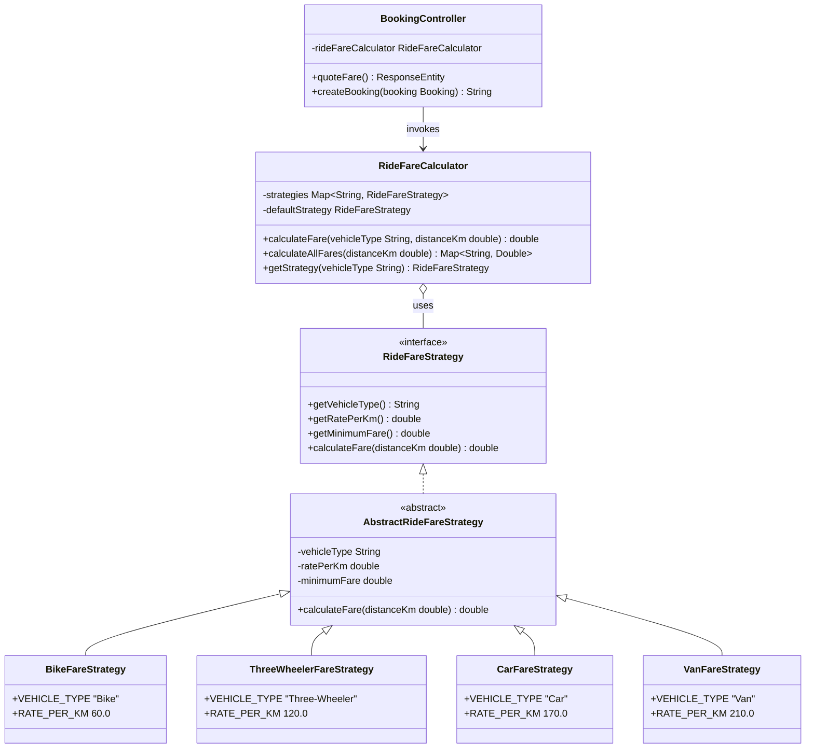
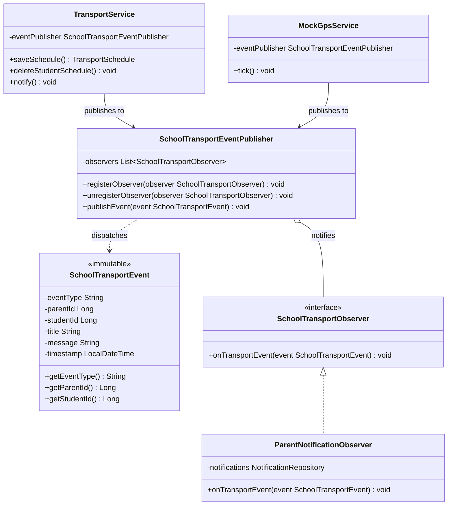
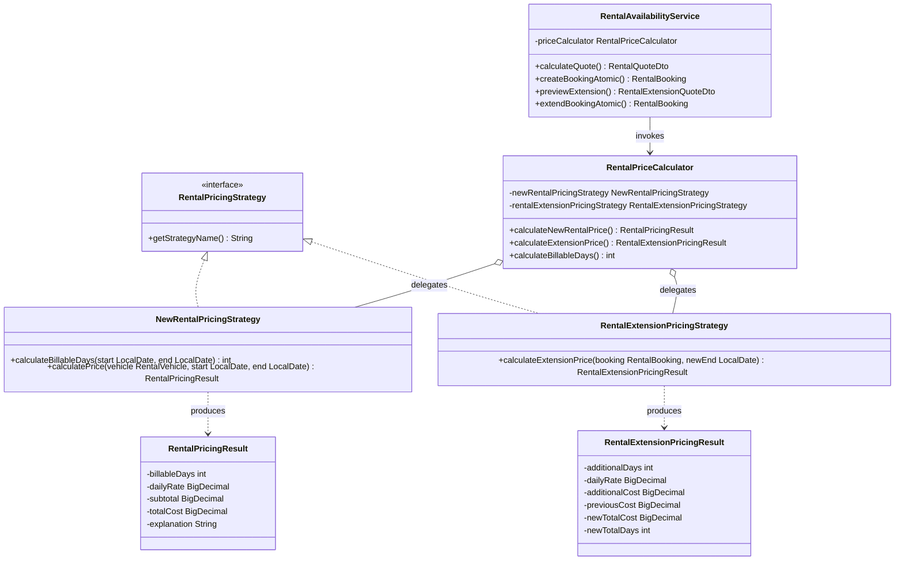
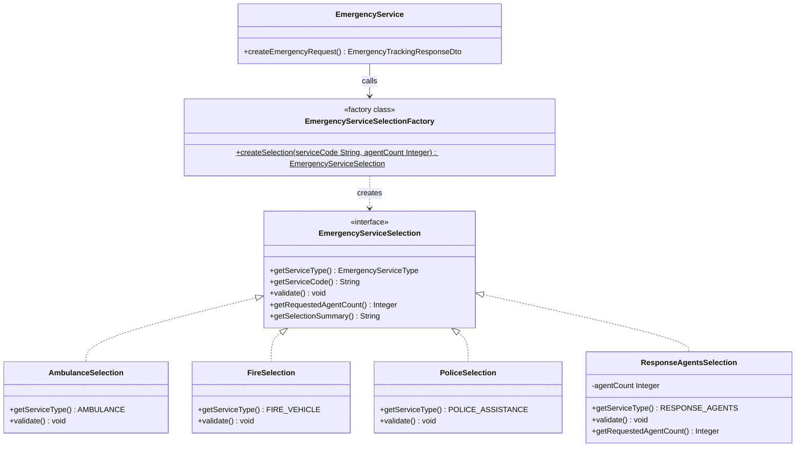

# NEXT GO Transport System — Design Patterns Integration Document

## Executive Summary
This document provides complete architectural documentation for the design patterns integrated into the **NEXT GO** multi-service platform across four core modules:
1. **Ride Booking** — **Strategy Pattern** for vehicle-specific fare calculations.
2. **School Transport** — **Observer Pattern** for decoupled event-driven parent notifications and route updates.
3. **Vehicle Rental** — **Strategy Pattern** for interchangeable rental creation and extension pricing algorithms.
4. **Emergency Services** — **Factory Pattern (Simple Factory)** for polymorphic service-specific validation and request preparation.

All integrations preserve 100% backward compatibility, existing interfaces, authentication isolation, database schemas, and business calculations. No Git operations were performed.

---

## 1. Ride Booking — Strategy Pattern

### Problem Addressed
Previously, vehicle fare calculations relied on client-side JavaScript approximations or hardcoded procedural logic scattered across controllers and views. Introducing new vehicle classes or adjusting rates required editing multiple conditionals, violating the **Open/Closed Principle (OCP)**.

### Pattern Solution
The **Strategy Pattern** defines a family of fare calculation algorithms, encapsulates each one inside a dedicated strategy class, and makes them interchangeable at runtime based on the requested vehicle type.

### Participants
- **`RideFareStrategy`** (`com.webtrans.ridebook.strategy`): Common interface defining `calculateFare(double distanceKm)`, `getVehicleType()`, `getRatePerKm()`, and `getMinimumFare()`.
- **`AbstractRideFareStrategy`** (`com.webtrans.ridebook.strategy`): Abstract base strategy encapsulating the exact minimum fare rule (`distance < 1.0 km -> minimumFare`) and standard rounding (`Math.round(distance * rate)`).
- **`BikeFareStrategy`** (`com.webtrans.ridebook.strategy`): Concrete strategy for `Bike` (Rate: 60 LKR/km, Min: 60 LKR).
- **`ThreeWheelerFareStrategy`** (`com.webtrans.ridebook.strategy`): Concrete strategy for `Three-Wheeler` / `Wheel` (Rate: 120 LKR/km, Min: 120 LKR).
- **`CarFareStrategy`** (`com.webtrans.ridebook.strategy`): Concrete strategy for `Car` (Rate: 170 LKR/km, Min: 170 LKR).
- **`VanFareStrategy`** (`com.webtrans.ridebook.strategy`): Concrete strategy for `Van` (Rate: 210 LKR/km, Min: 210 LKR).
- **`RideFareCalculator`** (`com.webtrans.ridebook.strategy`): Context class that registers all strategies, resolves aliases (e.g. `ThreeWheeler`, `Wheel`), provides fallback to default strategy (`Car`), and computes individual or comparative fares across all supported vehicle types.

### Production Call Chain
```text
HTTP GET /ride/api/fare/quote
  └── BookingController.quoteFare(vehicleType, distanceKm, pickupLat, pickupLng, dropLat, dropLng)
        └── RideFareCalculator.calculateFare(vehicleType, distanceKm)
              └── RideFareStrategy.calculateFare(distanceKm)  [e.g., BikeFareStrategy, CarFareStrategy]

HTTP POST /ride/book
  └── BookingController.createBooking(Booking booking, session, response)
        └── RideFareCalculator.calculateFare(booking.getVehicleType(), distanceKm)
              └── RideFareStrategy.calculateFare(distanceKm)
                    └── Booking.setFare(calculatedFare) -> BookingRepository.save(booking)
```

### Class Diagram


### Viva / Defense Explanation
- **Problem**: Vehicle-specific fare calculation was tightly coupled to client-side scripts, with no unified server-side strategy abstraction. Adding or modifying vehicle rates risked regressions in pricing.
- **Pattern Solution**: Strategy encapsulates each vehicle's rate and minimum-fare logic into independent, testable components managed by a `RideFareCalculator` context, achieving OCP and SRP.
- **Disadvantage / Trade-off**: Slightly increases class count and requires the client/context to understand or select the appropriate strategy identifier.

---

## 2. School Transport — Observer Pattern

### Problem Addressed
Previously, when bus telemetry changed, student schedules were updated, or a bus stopped at a student's stop, `TransportService` and `MockGpsService` directly called procedural database saves on `NotificationRepository`. This direct coupling made it difficult to attach new listeners (e.g. audit logging, telemetry monitors, arrival records) without editing core operational services.

### Pattern Solution
The **Observer Pattern** establishes a one-to-many dependency between a subject (`SchoolTransportEventPublisher`) and observers (`SchoolTransportObserver`). When school transport events occur, the subject notifies all registered observers without knowing their concrete implementations.

### Participants
- **`SchoolTransportEvent`** (`com.webtrans.school.observer`): Immutable value object carrying event metadata (`eventType`, `parentId`, `studentId`, `title`, `message`, `timestamp`).
- **`SchoolTransportObserver`** (`com.webtrans.school.observer`): Observer interface defining `void onTransportEvent(SchoolTransportEvent event)`.
- **`SchoolTransportEventPublisher`** (`com.webtrans.school.observer`): Subject/Publisher component maintaining a thread-safe list of `SchoolTransportObserver` instances with registration, deregistration, and publication methods.
- **`ParentNotificationObserver`** (`com.webtrans.school.observer`): Concrete observer delegating directly to `NotificationRepository`, enforcing verified parent/student scoping, and saving notification records inside the active Spring transaction.

### Production Call Chain
```text
1. Schedule Updates & Removals:
   TransportService.saveSchedule() / deleteStudentSchedule() / notify()
     └── SchoolTransportEventPublisher.publishEvent(SchoolTransportEvent event)
           └── ParentNotificationObserver.onTransportEvent(event)
                 └── NotificationRepository.save(Notification)

2. Bus GPS Arrival at Assigned Student Stop:
   MockGpsService.tick() [Scheduled GPS simulation]
     └── When bus reaches student stop radius (<= 120m)
           └── SchoolTransportEventPublisher.publishEvent(SchoolTransportEvent event)
                 └── ParentNotificationObserver.onTransportEvent(event)
                       └── NotificationRepository.save(Notification)
```

### Class Diagram


### Viva / Defense Explanation
- **Problem**: Operational services like `TransportService` and `MockGpsService` were tightly coupled to direct notification persistence, violating the Single Responsibility Principle.
- **Pattern Solution**: Observer decouples domain events (arrival, schedule change) from recipient reaction (parent notifications). Additional event listeners can now be attached without modifying service logic.
- **Disadvantage / Trade-off**: Observers are notified in an arbitrary or sequential order; an uncaught exception in a poorly implemented observer could interrupt the event delivery chain unless explicitly isolated with error handling.

---

## 3. Vehicle Rental — Strategy Pattern

### Problem Addressed
`RentalAvailabilityService` originally handled both initial 24-hour cycle rental quotes/bookings and incremental rental extensions with duplicate in-line arithmetic for billable days, rate lookups, subtotal multiplications, and rounding modes. Mixing pricing calculations with row locking and availability checks violated Single Responsibility.

### Pattern Solution
The **Strategy Pattern** separates the distinct pricing algorithms into two dedicated strategy components: `NewRentalPricingStrategy` (for initial bookings and day counting) and `RentalExtensionPricingStrategy` (for incremental extension pricing). The context `RentalPriceCalculator` exposes a clean facade consumed by both quotation and transactional booking flows.

### Participants
- **`RentalPricingStrategy`** (`com.webtrans.vehicle_rental.strategy`): Root interface identifying rental pricing strategies.
- **`RentalPricingResult`** (`com.webtrans.vehicle_rental.strategy`): Immutable value container for new rental price breakdowns (`billableDays`, `dailyRate`, `subtotal`, `totalCost`, `explanation`).
- **`RentalExtensionPricingResult`** (`com.webtrans.vehicle_rental.strategy`): Immutable value container for extension price breakdowns (`additionalDays`, `dailyRate`, `additionalCost`, `previousCost`, `newTotalCost`, `newTotalDays`).
- **`NewRentalPricingStrategy`** (`com.webtrans.vehicle_rental.strategy`): Encapsulates 24-hour cycle day calculation (`DAYS.between`, same-day min 1 day) and subtotal arithmetic (`dailyRate * billableDays`) with `HALF_UP` rounding.
- **`RentalExtensionPricingStrategy`** (`com.webtrans.vehicle_rental.strategy`): Encapsulates incremental date difference calculation (`DAYS.between(oldEndDate, newEndDate)`), incremental cost, and cumulative cost calculation.
- **`RentalPriceCalculator`** (`com.webtrans.vehicle_rental.strategy`): Context class consumed by `RentalAvailabilityService` across both quotation (`calculateQuote`, `previewExtension`) and confirmation flows (`createBookingAtomic`, `extendBookingAtomic`).

### Production Call Chain
```text
1. New Rental Quotation & Confirmation:
   RentalController.calculateQuote() / bookVehicle()
     └── RentalAvailabilityService.calculateQuote() / createBookingAtomic()
           └── RentalPriceCalculator.calculateNewRentalPrice(vehicle, startDate, endDate)
                 └── NewRentalPricingStrategy.calculatePrice(vehicle, startDate, endDate)
                       └── RentalPricingResult -> RentalQuoteDto / RentalBooking.save()

2. Rental Extension Quotation & Confirmation:
   RentalController.previewExtension() / extendBooking()
     └── RentalAvailabilityService.previewExtension() / extendBookingAtomic()
           └── RentalPriceCalculator.calculateExtensionPrice(booking, newEndDate)
                 └── RentalExtensionPricingStrategy.calculateExtensionPrice(booking, newEndDate)
                       └── RentalExtensionPricingResult -> RentalExtensionQuoteDto / RentalBooking.save()
```

### Class Diagram


### Viva / Defense Explanation
- **Problem**: Rental creation and rental extension have distinct financial rules (initial cycle vs incremental additions). Embedding this math directly in availability queries and row-locking logic created code duplication and made unit testing difficult.
- **Pattern Solution**: Strategy separates the new-booking algorithm from the extension algorithm into dedicated classes, unifying them under `RentalPriceCalculator` context.
- **Disadvantage / Trade-off**: Increases the number of DTO/result classes needed to pass typed calculation results back to the calling service.

---

## 4. Emergency Services — Factory Pattern (Simple Factory)

### Problem Addressed
When a citizen submits an emergency request, multiple distinct emergency services may be requested within a single incident (e.g. Ambulance, Fire, Police, and Emergency Response Agents). Previously, service validation and agent count enforcement were implemented procedurally using hardcoded string comparisons and nested conditional blocks in `EmergencyService`.

### Pattern Solution
The **Simple Factory Pattern** (the factory-class approach taught in software design lectures) encapsulates the instantiation of polymorphic `EmergencyServiceSelection` products behind `EmergencyServiceSelectionFactory`. Each concrete product encapsulates its own service type, service code, and service-specific validation rules (e.g., verifying that Response Agents count is an integer between 1 and 5 inclusive).

### Participants
- **`EmergencyServiceSelection`** (`com.webtrans.emergency.factory`): Common Product interface declaring `getServiceType()`, `getServiceCode()`, `validate()`, `getRequestedAgentCount()`, and `getSelectionSummary()`.
- **`AmbulanceSelection`** (`com.webtrans.emergency.factory`): Concrete Product for `AMBULANCE`. Self-validating with no agent parameters required.
- **`FireSelection`** (`com.webtrans.emergency.factory`): Concrete Product for `FIRE_VEHICLE`. Self-validating with no agent parameters required.
- **`PoliceSelection`** (`com.webtrans.emergency.factory`): Concrete Product for `POLICE_ASSISTANCE`. Self-validating with no agent parameters required.
- **`ResponseAgentsSelection`** (`com.webtrans.emergency.factory`): Concrete Product for `RESPONSE_AGENTS`. Enforces that `agentCount` is non-null and strictly between 1 and 5 inclusive (1 and 5 pass; 0, 6, and negative fail).
- **`EmergencyServiceSelectionFactory`** (`com.webtrans.emergency.factory`): The Simple Factory class providing `static EmergencyServiceSelection createSelection(String rawServiceCode, Integer agentCount)`.

### Production Call Chain
```text
HTTP POST /api/emergency/request
  └── EmergencyController.createRequest(EmergencyCreateRequestDto dto, request, session)
        └── EmergencyService.createEmergencyRequest(dto, clientIp, session)
              ├── For each requested service string:
              │     └── EmergencyServiceSelectionFactory.createSelection(serviceCode, dto.getAgentCount())
              │           └── Returns concrete product [AmbulanceSelection, ResponseAgentsSelection, etc.]
              ├── Product.validate()  [Enforces service rules, e.g., agent count 1..5]
              └── EmergencyRequest.builder().requestedServices(...).requestedAgentCount(...)
                    └── EmergencyRequestRepository.save(req)
```

### Class Diagram


### Viva / Defense Explanation
- **Problem**: Procedural service validation in `EmergencyService` mixed request parsing with service-specific domain rules, making adding new services (e.g., Disaster Management) require modifying large monolithic methods.
- **Pattern Solution**: The Simple Factory centralizes object creation, and each product self-validates its parameters, supporting clean multiple-service requests and enforcing the 1-5 agent boundary.
- **Disadvantage / Trade-off**: Because it is implemented as a Simple Factory (static creation method) rather than the GoF Factory Method pattern, adding a new emergency service still requires adding a case branch to the factory class.

---

## 5. Verification & Test Results

### Baseline Execution (Before Refactor)
- Total Tests: **80**
- Failures: **0**
- Errors: **0**
- Skipped: **0**

### Post-Refactor Execution (After Integrating All 4 Patterns)
- Total Tests: **95**
- Failures: **0**
- Errors: **0**
- Skipped: **0**
- Build Status: **`BUILD SUCCESS`**

### Summary of Executed Test Suites
| Test Suite Class | Tests Run | Result | Notes |
| :--- | :---: | :---: | :--- |
| `RideBookingStrategyTest` | 4 | **PASSED** | Tests rates (Bike: 60, Wheel: 120, Car: 170, Van: 210), minimum fare for <1km, calculator aliases, quote endpoint. |
| `SchoolTransportObserverTest` | 4 | **PASSED** | Tests event publisher, observer registration, parent-scoped notifications, and `TransportService.notify` delegation. |
| `RentalPricingStrategyTest` | 4 | **PASSED** | Tests same-day (1 day min), multi-day (24h cycle), extension calculation, and invalid date boundary rejection. |
| `EmergencyServiceFactoryTest` | 3 | **PASSED** | Tests Simple Factory creation, agent count boundaries (1 and 5 pass; 0, 6, -2, null fail), and invalid service rejection. |
| `EmergencyServicesTest` | 19 | **PASSED** | Verifies full emergency lifecycle, honest demo notice, token cryptography, CSRF, and admin workflows. |
| `RentalAvailabilityAndExtensionTest` | 13 | **PASSED** | Verifies overlap checking, date boundaries, pessimistic locking, and extension workflows. |
| `PassengerBookingOwnershipTest` | 10 | **PASSED** | Verifies strict session ownership, cancellation, reviews, and isolated history. |
| `RideAuthenticationAndIsolationTest` | 11 | **PASSED** | Verifies isolated driver/passenger logins, session boundaries, and logout cleanup. |
| `DriverProximityAndLogoutTest` | 7 | **PASSED** | Verifies 5 km proximity filter and driver state management. |
| `CourierIntegrationTest` | 15 | **PASSED** | Verifies untouched Courier module end-to-end functionality. |
| `AdminDashboardTest` | 4 | **PASSED** | Verifies admin analytics and module management. |
| `WebTransApplicationTests` | 1 | **PASSED** | Verifies Spring Boot ApplicationContext bootstrapping. |
| **TOTAL** | **95** | **BUILD SUCCESS** | **100% Passing** |
